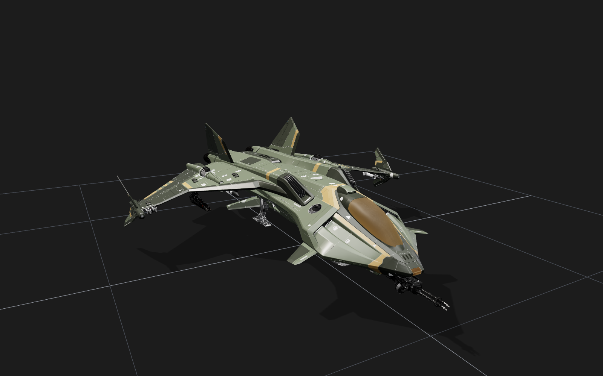
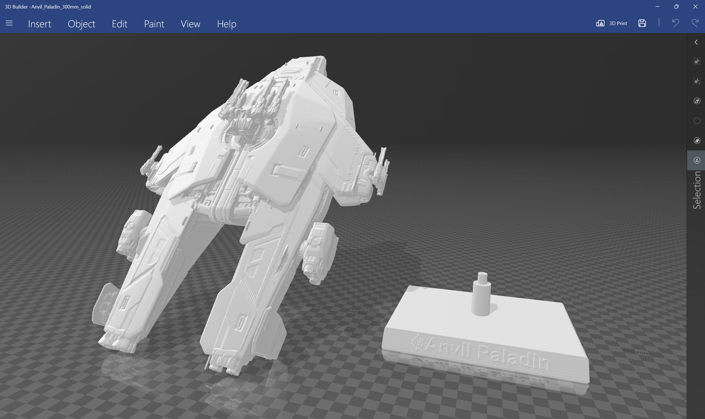
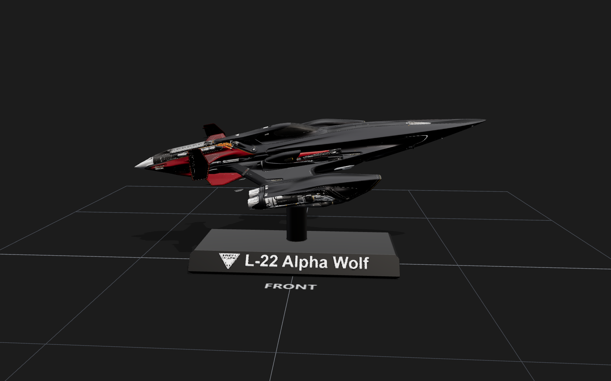
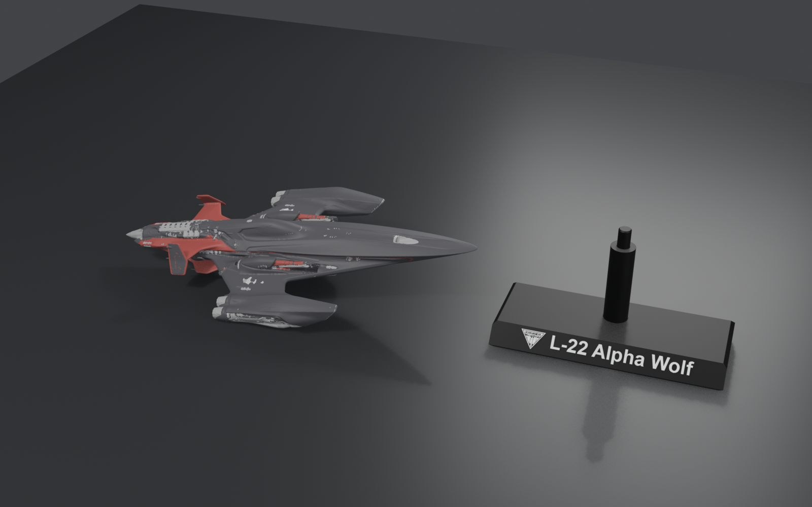

# Meshyard

Browse the vehicles, weapons, props and armor inside a game you own, look at them in 3D, and turn them into something you can print or open in Blender.

Meshyard reads the packed data files that CryEngine games ship with (`.p4k` archives holding `.cgf`, `.cga` and `.skin` models). Point it at a game's data file, or let it find one for you, and it builds a searchable list of everything inside.


It runs on your own PC against your own copy of the game. It only ever reads the game's data file. It doesn't talk to any game servers, and it never touches the game client or its anti-cheat. Anything you pull out of a game belongs to whoever made that game, so keep it for your own use and don't share the files around.

## Supported games

| Game | Data file | What works |
|------|-----------|------------|
| CryEngine Games | `Data.p4k`, with one folder per build (LIVE, PTU and so on) | Everything in this README: the full item list, paints, landing gear and other moving parts, characters, printing and export |

The game menu at the top of the window picks which kind of game to read. Next to it, **Find data files** looks through the usual game folders on every drive and lists every CryEngine data file it finds, so you can pick the one to browse or point it at one yourself. The app also runs that search on its own the first time it starts, so most people never need to touch it.

## Getting started

Grab **[Meshyard.exe](https://github.com/10-Gauge/Meshyard/releases/latest/download/Meshyard.exe)** and double-click it. There's no installer. It's around 200 MB, and the tools it uses to read game files come inside it.

The one thing it doesn't bring along is [Blender](https://www.blender.org/download/). Browsing, previews, 3D printing and most exports work fine without it. You only need it for the landing gear, weapon, VTOL and flight mode switches, for FBX, USDZ and `.blend` export, and for the sandbox. It's free. If the app can't find Blender, it tells you on first launch and gives you a download link. After that a note stays at the top of the window, with a **Check again** button for once you've installed it.

Windows SmartScreen will probably complain the first time because the exe isn't code-signed. Click *More info*, then *Run anyway*.

Every time you open the app it checks GitHub for a newer version. If there is one, a bar at the top says so. Click **Update now** and it downloads the new exe, swaps it in and restarts.

The first launch takes a little longer than usual:

1. It unpacks its tools into `%LOCALAPPDATA%\Meshyard\tools`. That takes a few seconds and only happens once per version.
2. It finds your game (see [Finding your game](#finding-your-game) below). If it can't, click **Find data files** at the top of the window. It lists every CryEngine data file it can find, and **Browse…** lets you pick one yourself.
3. It reads the game's item database and builds a search index. Give it a few minutes. This happens once per patch, and after that searching is instant.

## Using it

The pages down the left side are **Browse**, **Characters**, **Blender sandbox** and **Settings**.

### Browse

Search for anything by name, filter by category, and click a result to load it in the 3D view. Vehicles that come with liveries get a **Paint** list: pick one and the viewer, and anything you export from there, shows it in that paint. Liveries come through whole: each panel takes the color the livery gives it, metallic paints look metallic, and camo and stripe patterns show on the hull. The first time you pick a paint on a vehicle the app reads its liveries from the game, which takes a few seconds. A few liveries that use unusual material setups aren't supported yet. Drag to orbit, scroll to zoom, double-click to reset the camera. **Preview** loads a quick, lighter version; **Full detail** loads the real thing with all its textures.

If you have more than one build of a game installed (a live build and a test build, say), switch between them with the box at the top. They're indexed separately, so they never get mixed up.

For vehicles there are four switches in the panel on the right:

- **Landing gear** shows the vehicle with its gear up and the gear doors shut, taken from its own retract animation. The first time you do it for a vehicle it takes 10 to 30 seconds; after that it's instant. Some vehicles change shape on the ground, folding their wings or moving engines with their gear, and the app shows that shape with the gear down once you've raised the gear on that vehicle once.


*A ship in its stock paint with the landing gear down.*

- **Weapons** shows deployable guns out, like hidden cannon pods or folding missile racks. Vehicles with fixed guns just say so.
- **VTOL mode** swings the thrusters down for vertical flight. Vehicles without one just say so.
- **Flight mode** shows vehicles that fly in a different shape, with wings drawn in, spread out or stood upright.

All of them carry through to prints and exports, and you can use them together.

### 3D printing

First pick a size. You can give it either a **Scale** like 1:500 or a **Longest side** in millimeters, and the app fills in the other one from the model's real size in the game. If you're printing a fleet, set the scale once: it sticks as you move from one model to the next, so a small fighter and a large capital ship come out at the right size next to each other.

Click **Export printable file** and you get a single watertight 3MF or STL that drops straight into your slicer. Behind the scenes it does the cleanup you'd otherwise spend an evening on in Blender:

- Removes collision meshes, low-detail copies, shields and decals.
- Seals the gaps between hull panels and fills the inside so you get one solid body, no matter how messy the game mesh is.
- Thickens anything too thin to print, like antennas, gun barrels and fins. The default minimum is three nozzle widths. **Find thin parts…** lists them at your chosen size, in case you'd rather make one thicker or leave it off and use brass rod instead.
- Places it on the bed, Z up.



*A ship exported at 300 mm, with the peg stand and a name plate showing its maker's logo.*

**Detail** is the mesh resolution: 0.2 mm is a good default, 0.1 mm suits resin, and 0.3 to 0.4 mm is fine for a quick FDM print. Very large models keep up to 4 million triangles so panel lines and edges stay sharp.

**Paint colors** (3MF only) paints the print for a multi-color printer. Pick how many filaments you have, from 2 to 16, and the export colors every surface from the model: hull, trim, canopy and markings, reduced to that many colors. In Bambu Studio, import it into a project (File > Import, or Ctrl+I) and Bambu offers to match its colors to your filaments. Opening it as a project instead brings it in without the colors. The app lists the colors and names the closest Bambu PLA Basic color for each, so you know which spools to load. Pick a **Paint** first and the print comes out in that livery.

Some other options worth knowing:

- **Stand.** *Separate stand, pegs into a socket* prints a base and post, and cuts a matching socket under the model so you can print it flat and press it on. The other option fuses the stand to the model. The app puts the peg under the model's balance point on a broad part of the underside, clear of fins. The viewer shows where it will go, as an orange socket and a see-through post, and follows along when you change **Peg forward** or **Peg right** to move it somewhere else. Turn on **Show on stand** to see the whole model sitting on the stand those settings make, seen from the stand's front: base, post height, incline and tilt included. The front edge (where the name plate goes) shows lighter, with FRONT on the floor in front of it. A few seconds after you change a setting, the viewer swaps in the stand the export will build, at preview detail: plate, lettering, logo, posts and colors.
- **Base.** *Round*, or *Rectangle with name plate*. The name plate has a sloped front with raised lettering: the name, an optional smaller second line (a nickname, a motto, a date), and the maker's logo from the game files embossed beside the text. Turn on **Scale on the plate** to add the print scale too, like 1:85.
- **On the stand, the nose points to the right** when you face the stand's front (the name plate side), with the right wing toward you.
- **Base width** and **Base depth** set the base size (0 sizes it from the model). **Posts** adds a second post, fore and aft, for long or heavy prints. The note under the stand settings says how far the model's balance point sits inside the base edge, and warns if it would tip over.
- With **Paint colors** on, **Base color**, **Logo color**, **Text color** and **Second line color** pick the stand's filaments from the Bambu PLA Basic colors. They're added to the 3MF's filament list, reusing a model color that matches.
- **Incline** lifts the nose (negative dips it). **Tilt** banks the model: positive drops the right wing toward the front of the stand, negative drops the left wing away from it. The socket still comes out full depth at any angle.



*Show on stand: gear up and weapons deployed, on a black name plate base with the logo and name in white, at 10° incline and 15° tilt.*



*An example export of the model shown on its stand above, with the same settings. It's a Bambu 3MF that comes pre-painted: the model is split into four filament colors taken from the livery picked in the **Paint** list (here the stock paint), and the stand prints in black with the logo and name in white. Import it into a Bambu Studio project and Bambu matches each color to a filament. Exported at 150 mm (1:142).*

- **Hollow walls** for resin prints. Remember to add drain holes in your slicer.
- **Separate parts (kit)** gives you every part as its own body instead of one solid, for painting or building it up like a model kit.

Finished files go to `%LOCALAPPDATA%\Meshyard\exports`, and **Show in folder** takes you straight there.

Every print export is also written to a log (`print-log.csv` in the same folder), so you can always look up what scale you printed something at. The print panel shows when you last printed the selected item and at what scale, and **Print history…** lists everything. From the command line it's `meshyard prints`.

### Exporting models

**Export 3D model** writes the full model with textures as GLB, glTF, OBJ, Collada, PLY, STL or 3MF, and through Blender as FBX, USDZ or a `.blend` file. GLB, glTF, OBJ, DAE, FBX, USDZ and `.blend` keep the game's units (meters) and orientation. STL, 3MF and PLY come out in millimeters with Z up, which is what slicers and CAD programs expect.

### Characters

The character builder puts a figure together from the armor and clothing in the game. Pick a male or female body and a head, then whatever you want them wearing: undersuit, helmet, torso, arms, legs, clothing, hair. Click **Build character** and the print and export panels work on the figure just like they do on a vehicle. For a figure, the size is its height (75 mm is a good place to start) and the stand goes under its feet.

**Pose** has five options: standing with arms at the sides, aiming (standing or kneeling), and low ready (standing or kneeling). **Weapon** picks what they're holding, from every hand-held gun in the game, plus all their skins.

The poses come from the game itself. Each gun is held the way the game holds that type of weapon, using the game's own animations:

- Rifles, SMGs, shotguns, snipers, LMGs and grenade launchers get the rifle stance.
- Pistols get a two-handed stance.
- Heavy weapons and rocket launchers sit on the shoulder.
- The gun sits in the hand where the game puts it, and the other hand goes to that gun's own grip point.

Low ready holds the gun lowered across the body, stock at the chest and muzzle down to the left. Arms at the sides is the game's standing idle, with a rifle hanging down the back stock up, a heavy weapon hanging muzzle up on the right, or a pistol holstered on the thigh.

A few weapons don't have proper game animations, so they use a stance we built by hand. Every skin of a gun is held exactly like the base gun.

### Blender sandbox

Open the sandbox and Blender starts with a test scene: a ground grid, a sun, a camera and a 1.8 m figure for scale. Back in the app, choose **Spawn in Blender sandbox** on any asset and it appears in the scene. In Blender, press `N` and open the *Meshyard* tab.

**Spawn animated** brings a vehicle in with its animations, so you can work the landing gear, cargo doors, ramps and canopies from the *StarBreaker* tab.

Keep the app open while you use the sandbox. Blender talks to it to fetch the models.

The sandbox runs in the Blender you have installed. When you open it, the app adds two add-ons to that Blender: its own, and StarBreaker's.

## Finding your game

The app checks these places, in order:

1. Any game data you've picked yourself with **Find data files**, or under **Settings > Game**.
2. Game launchers' own settings and logs, which record where they installed their games.
3. If none of that turns anything up, it looks a few folders deep in the usual game folders on every drive from C: to Z: (the drive itself, Program Files, Games, and Steam and Epic libraries) and remembers what it finds.

When a game keeps several builds side by side (a live build and test builds), the app picks up each one. Most builds carry a small manifest file that says exactly which build it is. That's how the app notices a new patch and rebuilds its index for you, in the background, without being asked.

## When a patch lands

Usually you don't need to do anything. The new build is picked up and indexed on its own, and old caches are cleared out (two builds per channel are kept).

If a big patch changes the game's file formats and something stops working, go to **Settings > Tools** and click **Download or update** to get the newest StarBreaker and cgf-converter. Once you've updated a tool that way, the app keeps your newer version.

## Where things live

Everything the app writes goes in `%LOCALAPPDATA%\Meshyard`: settings, the tools, the search index for each build, cached models, and your exports. Versions before 1.7.0 used `%LOCALAPPDATA%\sc-sandbox`, and the first time a newer version starts it moves everything over, settings and all. Delete the Meshyard folder and you're back to a clean start. Nothing is written anywhere else, and nothing in your game folder is ever changed.

## The tools behind it

The app stands on the shoulders of some excellent free tools. StarBreaker and cgf-converter are included unchanged, each with its license and a note pointing to its source code. Blender is the one you install yourself.

| Tool | What it does here | License |
|------|-------------------|---------|
| [StarBreaker](https://github.com/diogotr7/StarBreaker) | Reads `.p4k` archives and the game database inside them, and exports vehicles with their loadouts. Its Blender add-on decodes the landing gear and weapon animations. | MIT |
| [cgf-converter](https://github.com/Markemp/Cryengine-Converter) | Converts single model files, character skeletons and animation files | GPL-2.0 |
| [Blender](https://www.blender.org) (not included) | The sandbox, the landing gear, weapon, VTOL and flight mode switches, and the FBX, USDZ and `.blend` exports | GPL-3.0 |
| [three.js](https://threejs.org) | The 3D view | MIT |

## For developers

Clone the repo and run the setup script. You'll need Python 3.10 or newer.

```powershell
git clone https://github.com/10-Gauge/Meshyard
cd Meshyard
powershell -ExecutionPolicy Bypass -File .\install.ps1
```

That sets up a virtual environment and downloads StarBreaker and cgf-converter. After that you can run the browser version with **Meshyard.cmd** (it opens in your web browser at http://127.0.0.1:8765), or use the command line:

```text
meshyard installs                          list the game builds found and whether each is indexed
meshyard update [-c PTU | --all]           index the current build
meshyard search fighter [-c PTU]           search the index
meshyard model <entity> --out model.glb    export a model as GLB
meshyard print <name> --size 200           printable 3MF, 200 mm long
meshyard print <name> --scale 100          printable 3MF at 1:100
meshyard print <name> --mode parts --format stl    one STL per part
meshyard print <name> --stand peg --list-thin      list parts too thin to print at that size
meshyard print my_model.glb --glb          make any GLB printable
meshyard export <name> -f fbx              FBX, OBJ, glTF, DAE, USDZ and so on
meshyard blender install | open            set up or open the Blender sandbox
meshyard tools update                      update StarBreaker and cgf-converter
meshyard schedule --time 09:00             re-index every day with Task Scheduler
meshyard config show | set KEY VALUE       settings (%LOCALAPPDATA%\Meshyard\settings.json)
```

If your game is somewhere unusual, tell it where: `meshyard config add-root "D:\Games\<game folder>"`.

### How it fits together

The desktop app (`desktop/`, C# and WinUI 3) is a front end. The real work happens in a Python engine (`scsandbox/`) that the app starts in the background and talks to over localhost. The 3D view is a three.js page in a WebView2 panel. When you close the window, the engine stops too.

- `installs.py` finds games and works out which build each one is.
- `catalog.py` builds the search index.
- `models.py` exports models, and `gear.py` poses landing gear, weapons, folded wings, VTOL and flight mode.
- `printprep.py` is the print pipeline.
- `characters.py` and `rig.py` build and pose figures.
- `server.py` and `web/` are the API and the viewer.
- `blender/` holds the sandbox add-on.

The command templates for StarBreaker and cgf-converter live in `settings.json` under `commands`. If a tool renames a flag, you can fix it there without touching the code.

### Building the exe

You'll need the [.NET 10 SDK](https://dot.net). Then run:

```powershell
powershell -ExecutionPolicy Bypass -File packaging\build_exe.ps1
```

That builds the engine with PyInstaller, publishes the app as a single file, and adds the tools to the end of it. `packaging\bundle_tools.py` collects the tools, which are the latest StarBreaker and cgf-converter releases. Two switches change what goes in:

- `-WithBlender` puts a portable Blender inside as well. That adds about 400 MB. It's downloaded from blender.org or one of its mirrors, checked against Blender's published checksum, and cached in `build\cache`.
- `-NoTools` leaves the tools out altogether, and the app downloads StarBreaker and cgf-converter on first run instead.

GitHub Actions runs the tests and builds the exe on every push, then publishes it as the rolling `desktop-latest` pre-release. Pushing a tag like `v1.0.0` builds the same way and publishes a numbered release, with its notes taken from `packaging\release-notes`.

### Tests

```bash
pip install -e .[dev]
pytest
```

The tests run the whole pipeline against a fake game install and a stand-in for StarBreaker, so you don't need any game, or even Windows, to run them.

## License

The code in this repo is under the [MIT License](LICENSE). That covers the code only. Game files, and anything you pull out of them, belong to the companies that made those games. Meshyard isn't made by, endorsed by or connected to any game developer or publisher. The bundled tools keep their own licenses, listed in [The tools behind it](#the-tools-behind-it).
