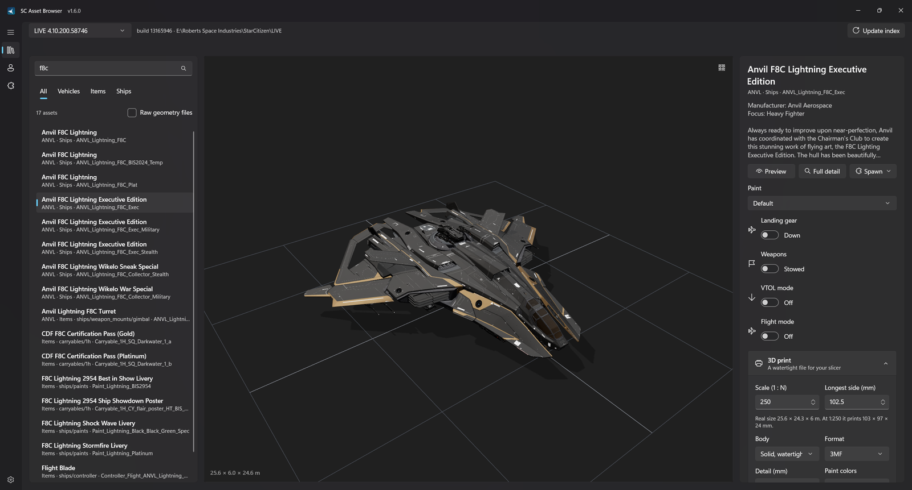

# SC Asset Browser

Browse every ship, vehicle, weapon, prop and piece of armor in your Star Citizen install, look at it in 3D, and turn it into something you can print or open in Blender.



It runs on your own PC against your own copy of the game. It only ever reads `Data.p4k`, it doesn't talk to CIG's servers, and it never touches the game client or Easy Anti-Cheat. Anything you pull out of the game is CIG's work, so keep it for your own use and don't share the files around.

## Getting started

Grab **[SC-Asset-Browser.exe](https://github.com/10-Gauge/SC-Asset-Browser/releases/latest/download/SC-Asset-Browser.exe)** and double-click it. There's no installer. It's around 200 MB, and the tools it uses to read the game files come inside it.

The one thing it doesn't bring along is [Blender](https://www.blender.org/download/). Browsing, previews, 3D printing and most exports work fine without it. You only need it for the landing gear, weapon, VTOL and flight mode switches, for FBX, USDZ and `.blend` export, and for the sandbox. It's free. If the app can't find Blender, it tells you on first launch and gives you a download link. After that a note stays at the top of the window, with a **Check again** button for once you've installed it.

Windows SmartScreen will probably complain the first time because the exe isn't code-signed. Click *More info*, then *Run anyway*.

Every time you open the app it checks GitHub for a newer version. If there is one, a bar at the top says so. Click **Update now** and it downloads the new exe, swaps it in and restarts.

The first launch takes a little longer than usual:

1. It unpacks its tools into `%LOCALAPPDATA%\sc-sandbox\tools`. That takes a few seconds and only happens once per version.
2. It finds your game (see [Finding your game](#finding-your-game) below). If it can't, click **Choose game folder…** and point it at your `StarCitizen` folder, the one with `LIVE` inside it.
3. It reads the game's item database and builds a search index. Give it a few minutes. This happens once per patch, and after that searching is instant.

## Using it

The pages down the left side are **Browse**, **Characters**, **Blender sandbox** and **Settings**.

### Browse

Search for anything by name, filter by category, and click a result to load it in the 3D view. Drag to orbit, scroll to zoom, double-click to reset the camera. **Preview** loads a quick, lighter version; **Full detail** loads the real thing with all its textures.

If you have LIVE and PTU installed, switch between them with the box at the top. They're indexed separately, so they never get mixed up.

For ships there are two switches in the panel on the right:

- **Landing gear** shows the ship with its gear up and the gear doors shut, taken from the ship's own retract animation. The first time you do it for a ship it takes 10 to 30 seconds; after that it's instant. Ships that fold their wings on the ground, like the Eclipse and the Stingray, or swing their engines down like the Mole and Moth, show them folded with the gear down once you've raised the gear on that ship once.
- **Weapons** shows deployable guns out, like the cannon pods on the Alpha Wolf or the guns and missile racks on the M80. Ships with fixed guns just say so.
- **VTOL mode** swings the thrusters down for vertical flight, like the Starlifter's wing nacelles, the Paladin or the Golem. Ships without one just say so.
- **Flight mode** opens the flaps the way the ship flies, like on the Stingray.

Both switches carry through to prints and exports, and you can use them together.

### 3D printing

First pick a size. You can give it either a **Scale** like 1:500 or a **Longest side** in millimeters, and the app fills in the other one from the model's real size in the game. If you're printing a fleet, set the scale once: it sticks as you move from ship to ship, so a Gladius and an Idris come out at the right size next to each other.

Click **Export printable file** and you get a single watertight 3MF or STL that drops straight into your slicer. Behind the scenes it does the cleanup you'd otherwise spend an evening on in Blender:

- Removes collision meshes, low-detail copies, shields and decals.
- Seals the gaps between hull panels and fills the inside so you get one solid body, no matter how messy the game mesh is.
- Thickens anything too thin to print, like antennas, gun barrels and fins. The default minimum is three nozzle widths. **Find thin parts…** lists them at your chosen size, in case you'd rather make one thicker or leave it off and use brass rod instead.
- Places it on the bed, Z up.


*An Anvil Paladin exported at 300 mm, with the peg stand and a name plate showing the Anvil logo.*

**Detail** is the mesh resolution: 0.2 mm is a good default, 0.1 mm suits resin, and 0.3 to 0.4 mm is fine for a quick FDM print. Very large models keep up to 4 million triangles so panel lines and edges stay sharp.

Some other options worth knowing:

- **Stand.** *Separate stand, pegs into a socket* prints a base and post, and cuts a matching socket under the model so you can print the ship flat and press it on. The other option fuses the stand to the model.
- **Base.** *Round*, or *Rectangle with name plate*. The name plate has a sloped front with raised lettering: the ship name, an optional smaller second line (a ship's own name, a motto, a date), and the manufacturer's logo embossed beside the text. Turn on **Scale on the plate** to add the print scale too, like 1:85.
- **Display angle** tilts the model nose up. The socket still comes out full depth when it's tilted.
- **Hollow walls** for resin prints. Remember to add drain holes in your slicer.
- **Separate parts (kit)** gives you every part as its own body instead of one solid, for painting or building it up like a model kit.

Finished files go to `%LOCALAPPDATA%\sc-sandbox\exports`, and **Show in folder** takes you straight there.

Every print export is also written to a log (`print-log.csv` in the same folder), so you can always look up what scale you printed something at. The print panel shows when you last printed the selected item and at what scale, and **Print history…** lists everything. From the command line it's `sc-sandbox prints`.

### Exporting models

**Export 3D model** writes the full model with textures as GLB, glTF, OBJ, Collada, PLY, STL or 3MF, and through Blender as FBX, USDZ or a `.blend` file. GLB, glTF, OBJ, DAE, FBX, USDZ and `.blend` keep the game's units (meters) and orientation. STL, 3MF and PLY come out in millimeters with Z up, which is what slicers and CAD programs expect.

### Characters

The character builder puts a figure together from the armor and clothing in your install. Pick a male or female body and a head, then whatever you want them wearing: undersuit, helmet, torso, arms, legs, clothing, hair. Click **Build character** and the print and export panels work on the figure just like they do on a ship. For a figure, the size is its height (75 mm is a good place to start) and the stand goes under its feet.

**Pose** has five options: standing with arms at the sides, aiming (standing or kneeling), and low ready (standing or kneeling). **Weapon** picks what they're holding, and there are 51 different guns to choose from, plus all their skins.

The poses come from the game itself. Each gun is held the way the game holds that type of weapon, using the game's own animations:

- Rifles, SMGs, shotguns, snipers, LMGs, the grenade launcher and the crossbow get the rifle stance.
- Pistols get a two-handed stance.
- The railgun and rocket launchers sit on the shoulder.
- The gun sits in the hand where the game puts it, and the other hand goes to that gun's own grip point.

Low ready is the same stance with the muzzle tipped down. Arms at the sides is the game's standing idle, with the gun slung across the back, or holstered on the thigh for a pistol.

A few cases don't have proper game animations, so they use a stance we built by hand: the Vendetta HMG (carried at the hip) and launchers on the female body. Every skin of a gun is held exactly like the base gun.

### Blender sandbox

Open the sandbox and Blender starts with a test scene: a ground grid, a sun, a camera and a 1.8 m figure for scale. Back in the app, choose **Spawn in Blender sandbox** on any asset and it appears in the scene. In Blender, press `N` and open the *SC Sandbox* tab.

**Spawn animated** brings a ship in with its animations, so you can work the landing gear, cargo doors, ramps and canopies from the *StarBreaker* tab.

Keep the app open while you use the sandbox. Blender talks to it to fetch the models.

The sandbox runs in the Blender you have installed. When you open it, the app adds two add-ons to that Blender: its own, and StarBreaker's.

## Finding your game

The app checks these places, in order:

1. Any folder you've added yourself, under **Settings > Game** or with **Choose game folder…**.
2. The RSI Launcher's own settings and logs in `%APPDATA%\rsilauncher`, which record where it installed the game.
3. The usual install spots on every drive from C: to Z:, like `Program Files\Roberts Space Industries\StarCitizen`.
4. If none of that turns anything up, it looks a few folders deep on each drive for a folder called `StarCitizen`.

Inside that folder it picks up `LIVE`, `PTU`, `EPTU`, `HOTFIX` and `TECH-PREVIEW`. Each has a `build_manifest.id` file that says exactly which build it is. That's how the app notices a new patch and rebuilds its index for you, in the background, without being asked.

## When a patch lands

Usually you don't need to do anything. The new build is picked up and indexed on its own, and old caches are cleared out (two builds per channel are kept).

If a big patch changes the game's file formats and something stops working, go to **Settings > Tools** and click **Download or update** to get the newest StarBreaker and cgf-converter. Once you've updated a tool that way, the app keeps your newer version.

## Where things live

Everything the app writes goes in `%LOCALAPPDATA%\sc-sandbox`: settings, the tools, the search index for each build, cached models, and your exports. Delete that folder and you're back to a clean start. Nothing is written anywhere else, and nothing in your game folder is ever changed.

## The tools behind it

The app stands on the shoulders of some excellent free tools. StarBreaker and cgf-converter are included unchanged, each with its license and a note pointing to its source code. Blender is the one you install yourself.

| Tool | What it does here | License |
|------|-------------------|---------|
| [StarBreaker](https://github.com/diogotr7/StarBreaker) | Reads `Data.p4k` and the game database, and exports ships with their loadouts. Its Blender add-on decodes the landing gear and weapon animations. | MIT |
| [cgf-converter](https://github.com/Markemp/Cryengine-Converter) | Converts single model files, character skeletons and the game's animation files | GPL-2.0 |
| [Blender](https://www.blender.org) (not included) | The sandbox, the landing gear, weapon, VTOL and flight mode switches, and the FBX, USDZ and `.blend` exports | GPL-3.0 |
| [three.js](https://threejs.org) | The 3D view | MIT |

## For developers

Clone the repo and run the setup script. You'll need Python 3.10 or newer.

```powershell
git clone https://github.com/10-Gauge/SC-Asset-Browser
cd SC-Asset-Browser
powershell -ExecutionPolicy Bypass -File .\install.ps1
```

That sets up a virtual environment and downloads StarBreaker and cgf-converter. After that you can run the browser version with **SC Asset Browser.cmd** (it opens in your web browser at http://127.0.0.1:8765), or use the command line:

```text
sc-sandbox installs                          list the installs found and whether each is indexed
sc-sandbox update [-c PTU | --all]           index the current build
sc-sandbox search gladius [-c PTU]           search the index
sc-sandbox model AEGS_Gladius --out g.glb    export a model as GLB
sc-sandbox print gladius --size 200          printable 3MF, 200 mm long
sc-sandbox print gladius --scale 100         printable 3MF at 1:100
sc-sandbox print gladius --mode parts --format stl   one STL per part
sc-sandbox print gladius --stand peg --list-thin     list parts too thin to print at that size
sc-sandbox print my_model.glb --glb          make any GLB printable
sc-sandbox export gladius -f fbx             FBX, OBJ, glTF, DAE, USDZ and so on
sc-sandbox blender install | open            set up or open the Blender sandbox
sc-sandbox tools update                      update StarBreaker and cgf-converter
sc-sandbox schedule --time 09:00             re-index every day with Task Scheduler
sc-sandbox config show | set KEY VALUE       settings (%LOCALAPPDATA%\sc-sandbox\settings.json)
```

If your game is somewhere unusual, tell it where: `sc-sandbox config add-root "D:\Games\StarCitizen"`.

### How it fits together

The desktop app (`desktop/`, C# and WinUI 3) is a front end. The real work happens in a Python engine (`scsandbox/`) that the app starts in the background and talks to over localhost. The 3D view is a three.js page in a WebView2 panel. When you close the window, the engine stops too.

- `installs.py` finds the game and works out which build it is.
- `catalog.py` builds the search index.
- `models.py` exports models, and `gear.py` poses landing gear, weapons, folded wings, VTOL and flight mode.
- `printprep.py` is the print pipeline.
- `characters.py` and `rig.py` build and pose figures.
- `server.py` and `web/` are the API and the viewer.
- `blender/` holds the sandbox add-on.

The command templates for StarBreaker and cgf-converter live in `settings.json` under `commands`. If a tool renames a flag, you can fix it there without touching the code.

### Building the exe

You'll need the [.NET 10 SDK](https://dot.net). Then run:

```powershell
powershell -ExecutionPolicy Bypass -File packaging\build_exe.ps1
```

That builds the engine with PyInstaller, publishes the app as a single file, and adds the tools to the end of it. `packaging\bundle_tools.py` collects the tools, which are the latest StarBreaker and cgf-converter releases. Two switches change what goes in:

- `-WithBlender` puts a portable Blender inside as well. That adds about 400 MB. It's downloaded from blender.org or one of its mirrors, checked against Blender's published checksum, and cached in `build\cache`.
- `-NoTools` leaves the tools out altogether, and the app downloads StarBreaker and cgf-converter on first run instead.

GitHub Actions runs the tests and builds the exe on every push, then publishes it as the rolling `desktop-latest` pre-release. Pushing a tag like `v1.0.0` builds the same way and publishes a numbered release, with its notes taken from `packaging\release-notes`.

### Tests

```bash
pip install -e .[dev]
pytest
```

The tests run the whole pipeline against a fake game install and a stand-in for StarBreaker, so you don't need the game, or even Windows, to run them.

## License

The code in this repo is under the [MIT License](LICENSE). That covers the code only. The game files, and anything you pull out of them, belong to Cloud Imperium Games. The bundled tools keep their own licenses, listed in [The tools behind it](#the-tools-behind-it).
